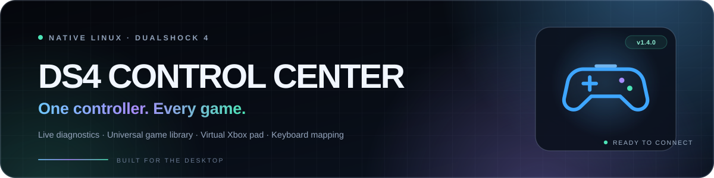
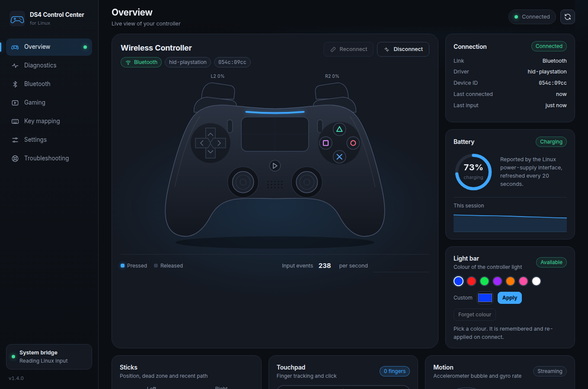
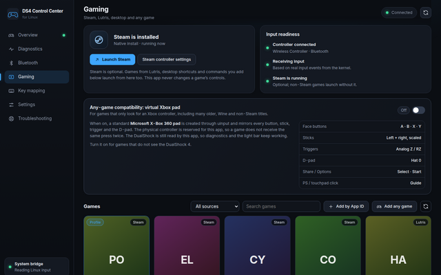
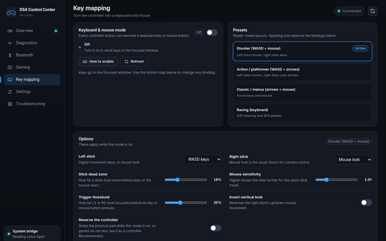
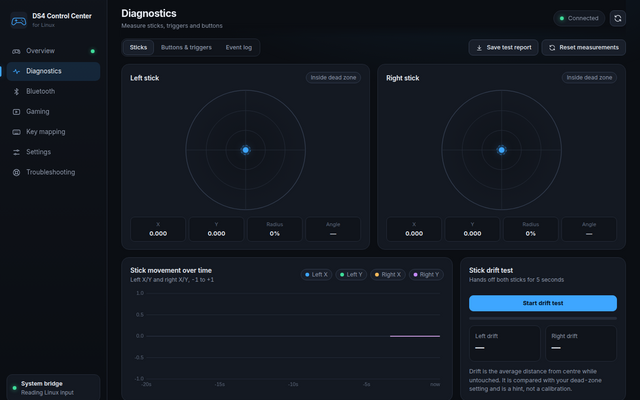
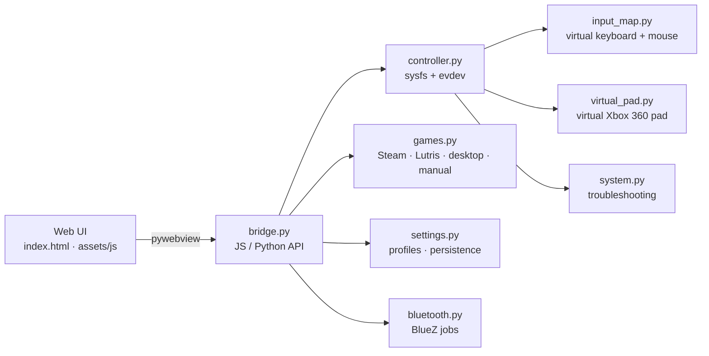

<a id="readme-top"></a>

<div align="center">
  <a href="https://abdulz0.github.io/ds4-control-center/">
    
  </a>
</div>

<h1 align="center">DS4 Control Center</h1>

<p align="center">
  <strong>A native Linux cockpit for the Sony DualShock 4.</strong><br>
  Live diagnostics, a universal game library, a virtual Xbox 360 pad, and full keyboard & mouse mapping — with no invented readings.
</p>

<p align="center">
  <a href="https://abdulz0.github.io/ds4-control-center/"></a>
  <a href="docs/releases/v1.4.0.md"></a>
  
  
  <a href="#testing"></a>
  <a href="https://github.com/AbduLz0/ds4-control-center/stargazers"></a>
</p>

<p align="center">
  <a href="#features">Features</a> ·
  <a href="#screenshots">Screenshots</a> ·
  <a href="#install">Install</a> ·
  <a href="#usage">Usage</a> ·
  <a href="#architecture">Architecture</a> ·
  <a href="#testing">Testing</a> ·
  <a href="#limitations">Limitations</a> ·
  <a href="https://abdulz0.github.io/ds4-control-center/">Website</a>
</p>

<div align="center">
  <a href="docs/screenshots/overview-v1.4.png"></a>
</div>

<p align="center">
  <sub>Captured from the real frontend with simulated controller data for documentation.</sub>
</p>

> **Honest by design.** Every value comes from the Linux kernel or from files the app reads.
> When battery, touchpad, motion or trigger pressure is unavailable, the app says **unavailable** —
> it never shows a made-up number or a fake connection.

## Features

### Know the controller

- **Live controller illustration** — all 18 buttons light up in real time, sticks move on the body, L2/R2 fill with real analog pressure, and the touchpad shows up to two fingers.
- **Diagnostics with context** — a timed 5-second drift test, circularity map, 18-button tester with press counts, trigger graph, rumble test and filterable event log.
- **Battery, motion and touch** — session battery graph, estimated drain rate, low-battery alert, accelerometer bubble and gyro bars.
- **Test report** — save drift, circularity, button coverage, trigger and battery results to a transparent Markdown report.

### Play the games you own

- **Not Steam-only.** Steam, Lutris, desktop shortcuts and manually added commands live in one source-filtered library.
- **Per-game profiles** — a dead-zone guide and notes for each game. Profiles follow the game that is actually running, even when you start it outside this app.
- **Read-only detection** — Steam's `registry.vdf`, Lutris's `pga.db`, `.desktop` entries and `/proc` are read, never modified.
- **Safe launching** — Steam URIs, Lutris's documented URI, `gio launch` for desktop entries, and `shlex`-parsed commands with no shell injection.

### Make any game see it

- **Virtual Xbox 360 pad** — a standard `Microsoft X-Box 360 pad` is created through uinput and mirrors every button, stick, analog trigger and D-pad direction. The physical controller is reserved while it is on, so games do not receive double input.
- **Keyboard & mouse mode** — turn all 18 inputs into keyboard keys, mouse buttons or wheel actions. Four ready presets, click-to-rebind, mouse-look sensitivity, dead zone, invert Y and trigger threshold.
- **Honest permission handling** — if `/dev/uinput` is root-only, the app says so and keeps working. The optional helper adds one udev rule with your confirmation.

### Built for Linux

- **Native stack** — Python + GTK/WebKit, `python-evdev`, BlueZ and `notify-send`. No Electron, no telemetry, no account.
- **No root to run** — the app refuses to start as root and never edits system settings by itself.
- **Four themes, saved settings, responsive UI** — works in a normal desktop session on X11 or Wayland through GTK.
- **Release discipline** — 129 backend tests, a headless UI suite and an explicit limitation list. See the [v1.4.0 release notes](docs/releases/v1.4.0.md).

## Screenshots

| Gaming — universal library | Key mapping | Diagnostics |
|:---:|:---:|:---:|
| <a href="docs/screenshots/gaming-v1.4.png"></a> | <a href="docs/screenshots/mapping-v1.4.png"></a> | <a href="docs/screenshots/diagnostics-v1.4.png"></a> |
| **Steam + Lutris + desktop + manual** | **Four presets, 18 bindings** | **Drift, circularity, triggers** |

<p align="center">
  <a href="docs/README.md">Open the full screenshot gallery</a> ·
  <a href="https://abdulz0.github.io/ds4-control-center/#gallery">View the interactive gallery</a>
</p>

<p align="center"><sub>Screenshots use the real frontend with the test bridge. Connection state, input readings, battery values and game entries are simulated for documentation; they are not hardware or in-game compatibility proof.</sub></p>

## Any-game support

### Universal library

| Source | Discovered from | Launch path |
|---|---|---|
| **Steam** | `appmanifest_*.acf`, library folders, registry | `steam://rungameid/<appid>` |
| **Lutris** | Read-only `pga.db` | `lutris:rungameid/<id>` |
| **Desktop** | `.desktop` entries with `Categories=Game;` | `gio launch` / `gtk-launch` |
| **Manual** | A command you add, e.g. `wine ~/Games/foo/foo.exe` | `shlex` + direct spawn |

This covers native games, Flatpak Steam, Heroic and Bottles shortcuts, itch titles, Wine/Proton games and hand-made launchers. Unusual installs can always be added manually.

### Virtual Xbox 360 pad

For games that only look for XInput-style controllers, turn on **Any-game compatibility** on the Gaming page. The app creates a standard Microsoft Xbox 360 device through uinput and forwards the current controller state to it.

<details>
<summary><strong>DualShock 4 → Xbox 360 mapping</strong></summary>

| DualShock 4 | Xbox 360 |
|---|---|
| Cross / Circle / Square / Triangle | A / B / X / Y |
| L1 / R1 | LB / RB |
| L2 / R2 | Analog LT / RT + digital triggers |
| L3 / R3 | Left / right stick clicks |
| Share / Options | Back / Start |
| PS / touchpad click | Guide |
| D-pad | Hat 0X / 0Y |
| Both sticks | Scaled with a radial dead zone |

</details>

> [!IMPORTANT]
> The virtual keyboard, mouse and Xbox pad need write access to `/dev/uinput`, which is root-only on many distributions.
> Run `./scripts/enable-uinput.sh` once and follow its instructions to add one udev rule and a module-load entry.
> The helper asks before changing anything; the app never runs it automatically.

The virtual pad does not forward force feedback, motion or touch gestures. While it is on, the physical pad is reserved for this app so the game does not see two controllers.

## Keyboard & mouse mode

Left stick becomes WASD, right stick becomes mouse look, triggers become aim and fire. Start with a preset, then make it yours.

| Preset | Left stick | Right stick | Good for |
|---|---|---|---|
| **Shooter** | WASD | Mouse look | FPS and third-person action |
| **Action / platformer** | WASD | Arrow keys | 2D and 3D action games |
| **Classic / menus** | Arrow keys | Mouse | Point-and-click, visual novels, older titles |
| **Racing** | A / D steering | — | Arcade and sim racing |

- Rebind any of the 18 inputs by clicking **Rebind**, then pressing a key or mouse button.
- Adjust mouse sensitivity, dead zone, vertical inversion, trigger threshold and whether to reserve the controller.
- See held virtual keys in real time on the Key mapping page.

> [!WARNING]
> Keys go to whichever window has focus. Some games with anti-cheat ignore or block synthetic input; this app does not try to bypass anti-cheat. Do not run Steam Input remapping and this mapper for the same game at the same time.

## Install

### Requirements

- A Linux desktop based on **Zorin OS 17/18, Ubuntu 22.04/24.04 or Debian**
- **Python 3.8+**
- A DualShock 4 connected over USB or Bluetooth
- GTK/WebKit, `python-evdev`, BlueZ and `libnotify-bin` — `install.sh` installs these for you

### Quick start

```bash
git clone https://github.com/AbduLz0/ds4-control-center.git
cd ds4-control-center

./install.sh    # explains every package and asks before using apt
./run.sh        # launch the dashboard
```

Optional desktop launcher:

```bash
./install-desktop-launcher.sh
```

### Optional: virtual input

Only needed for **Keyboard & mouse mode** and the **virtual Xbox 360 pad**:

```bash
./scripts/enable-uinput.sh
# log out and back in if the helper asks you to
```

The helper is explicit and reversible:

```bash
./scripts/enable-uinput.sh --remove
```

<details>
<summary><strong>Manual dependency installation</strong></summary>

```bash
sudo apt install python3-venv python3-gi python3-gi-cairo \
  gir1.2-gtk-3.0 gir1.2-webkit2-4.1 python3-evdev bluez libnotify-bin
./install.sh --no-apt
```

On older Ubuntu bases, use `gir1.2-webkit2-4.0` instead of `-4.1`.

</details>

<details>
<summary><strong>Renderer overrides and graphics troubleshooting</strong></summary>

GTK is the default renderer. If you have Qt dependencies installed:

```bash
PYWEBVIEW_GUI=qt ./run.sh
```

The WebKit graphics workarounds are enabled by default. Override them only when troubleshooting:

```bash
WEBKIT_DISABLE_COMPOSITING_MODE=0 WEBKIT_DISABLE_DMABUF_RENDERER=0 ./run.sh
```

</details>

## Usage

| Page | What it does |
|---|---|
| **Overview** | Live controller, connection, battery, sticks, touchpad, motion and recent input. Reconnect and Disconnect live here. |
| **Diagnostics** | Stick pads, drift test, circularity, button tester, trigger graph, rumble and event log. |
| **Bluetooth** | Adapter power, scan, pair, connect, disconnect, forget and optional auto-reconnect. |
| **Gaming** | Steam, Lutris, desktop and manual games, virtual Xbox pad and per-game profiles. |
| **Key mapping** | Presets, all 18 bindings, tuning options and live virtual output. |
| **Settings** | Themes, refresh rate, alerts, idle disconnect, autostart and game detection. |
| **Troubleshooting** | Read-only system check with fix hints and a copyable report. |

**Keyboard shortcuts:** `1`–`7` switch pages. On Diagnostics, `S` saves a test report, `D` starts the drift test and `R` resets measurements. `?` opens the shortcut list. Shortcuts are ignored while you type in a field.

**Settings and data**

- Settings: `~/.config/ds4-control-center/settings.json`
- Reports and logs: `~/.local/state/ds4-control-center/`
- The app uses a single-instance lock and starts minimized if you choose that in Settings.

## Architecture



| Module | Responsibility |
|---|---|
| `app/ds4cc/controller.py` | DS4 node discovery, input state, rumble, exclusive grab |
| `app/ds4cc/input_map.py` | Pure mapping engine, presets, uinput keyboard/mouse |
| `app/ds4cc/virtual_pad.py` | Pure Xbox 360 state machine and virtual device |
| `app/ds4cc/games.py` | Universal library, safe launching, running-game detection |
| `app/ds4cc/settings.py` | Validated settings, per-game profiles, custom games |
| `app/ds4cc/bridge.py` | Public API used by the page |
| `app/ds4cc/power.py` | Battery history, low-battery and idle logic |
| `app/ds4cc/lightbar.py` | Light bar through sysfs LEDs |
| `app/ds4cc/bluetooth.py` | Pair, trust, connect and disconnect jobs |
| `app/ds4cc/system.py` | Read-only system checks |

**Design principles**

- **Kernel first.** Device discovery reads `/sys/class/input` and input comes from evdev. No guessing from marketing names.
- **Honest failure.** Permissions, unsupported features and missing data are reported in plain language.
- **Normal user only.** The app never edits udev rules or system settings itself. The optional uinput helper is separate and explicit.

## Testing

```bash
python3 -m unittest discover -s tests -v
```

**129 backend tests** cover controller mapping, settings recovery, battery and idle logic, light bar, Bluetooth parsing, the universal game library, desktop/Lutris discovery, the Xbox state machine, key mapping, settings persistence and the bridge API. No hardware is required: sysfs, uinput devices and the JavaScript bridge are simulated.

Optional headless UI suite:

```bash
python3 -m pip install playwright
python3 -m playwright install chromium
python3 tests/ui_smoke.py /tmp/ds4-shots
```

The UI test drives the real frontend through `tests/ui_mock.js` and covers the dashboard, diagnostics, Bluetooth, gaming, key mapping, responsive layout and no-bridge behavior.

## Limitations

| Area | Honest status |
|---|---|
| **Physical DualShock 4** | Not yet verified on real hardware. Mapping follows the kernel's documented `hid-playstation` behavior and is tested with simulated events and fake sysfs. |
| **Virtual pad fidelity** | Buttons, sticks, triggers and D-pad are forwarded. Force feedback, motion and touch gestures are not. |
| **Keyboard mapping** | Global to the focused window; not per-game. Anti-cheat may ignore synthetic input. |
| **uinput** | Root-only on many systems until the optional helper is installed. |
| **Steam Input** | Do not stack it with the virtual pad or keyboard mapper for the same game. |
| **Light bar** | The sysfs LED files are often read-only; the app says so instead of pretending. |
| **Battery** | `N/A` means the kernel did not report a battery. It does not mean 0%. |
| **Trigger pressure** | Only shown when the driver exposes analog trigger axes. |
| **Game detection** | Steam, Lutris, desktop entries and `/proc` — all read-only. Unusual installs may need **Add any game**. |
| **Notifications** | Need `notify-send` from `libnotify-bin`. |
| **Wayland / X11** | Expected to work through GTK; the app logic and headless UI were tested. |

## Troubleshooting

Start with the **Troubleshooting** page or run the read-only report:

```bash
./scripts/diagnose.sh
```

| Symptom | Try |
|---|---|
| **No controller found** | Connect USB, or hold **Share + PS** until the light bar flashes, then pair on Bluetooth. Check `hid-playstation` is loaded. |
| **Controller found but unreadable** | Run the app from your desktop session, not SSH or `sudo`. Check `ls -l /dev/input/event*`. |
| **Keyboard mode says it needs permission** | Run `./scripts/enable-uinput.sh`, then log out and back in. Check `ls -l /dev/uinput`. |
| **Game does not see the controller** | Enable the virtual Xbox pad before launching the game and turn off Steam Input for that title. |
| **Keyboard input goes to the wrong window** | Keys follow focus: click the game window. Enable **Reserve the controller** if the game also sees the physical pad. |
| **Bluetooth unavailable** | `systemctl status bluetooth`, `rfkill list`, `bluetoothctl show`. |
| **Blank window** | Install the GTK/WebKit packages and run `./run.sh` from a terminal to read the error. |

## Contributing

Bug reports, feature ideas and pull requests are welcome.

- Open an [issue](https://github.com/AbduLz0/ds4-control-center/issues) with your distribution, kernel version, controller connection type (USB/Bluetooth) and the output of `./scripts/diagnose.sh`.
- Run the backend tests before opening a pull request: `python3 -m unittest discover -s tests -v`.
- If you can test on a physical DualShock 4, a specific desktop environment or a game that ignores the controller, your report is especially useful. Real-hardware behavior is the most valuable gap to close.
- UI changes should keep the no-fake-data rule: if a value is unavailable, show that, not a placeholder.

<p align="center">
  <strong>If DS4 Control Center is useful to you, consider giving it a star.</strong><br>
  <a href="https://github.com/AbduLz0/ds4-control-center/stargazers">Star the repository</a> ·
  <a href="https://abdulz0.github.io/ds4-control-center/">Visit the website</a> ·
  <a href="docs/README.md">Screenshot gallery</a>
</p>

## Acknowledgements

Built with [pywebview](https://pywebview.flowrl.com/), [python-evdev](https://python-evdev.readthedocs.io/), GTK/WebKit, BlueZ and `notify-send`. The project’s landing page is at [abdulz0.github.io/ds4-control-center](https://abdulz0.github.io/ds4-control-center/), with source and screenshots in [`docs/`](docs/index.html).

<p align="center">
  <sub>DS4 Control Center is an independent project, not affiliated with Sony. DualShock is a trademark of Sony Interactive Entertainment.</sub><br>
  <sub>Screenshots use simulated test data and do not represent physical-controller or in-game compatibility verification.</sub><br><br>
  <a href="#readme-top">Back to top ↑</a>
</p>
