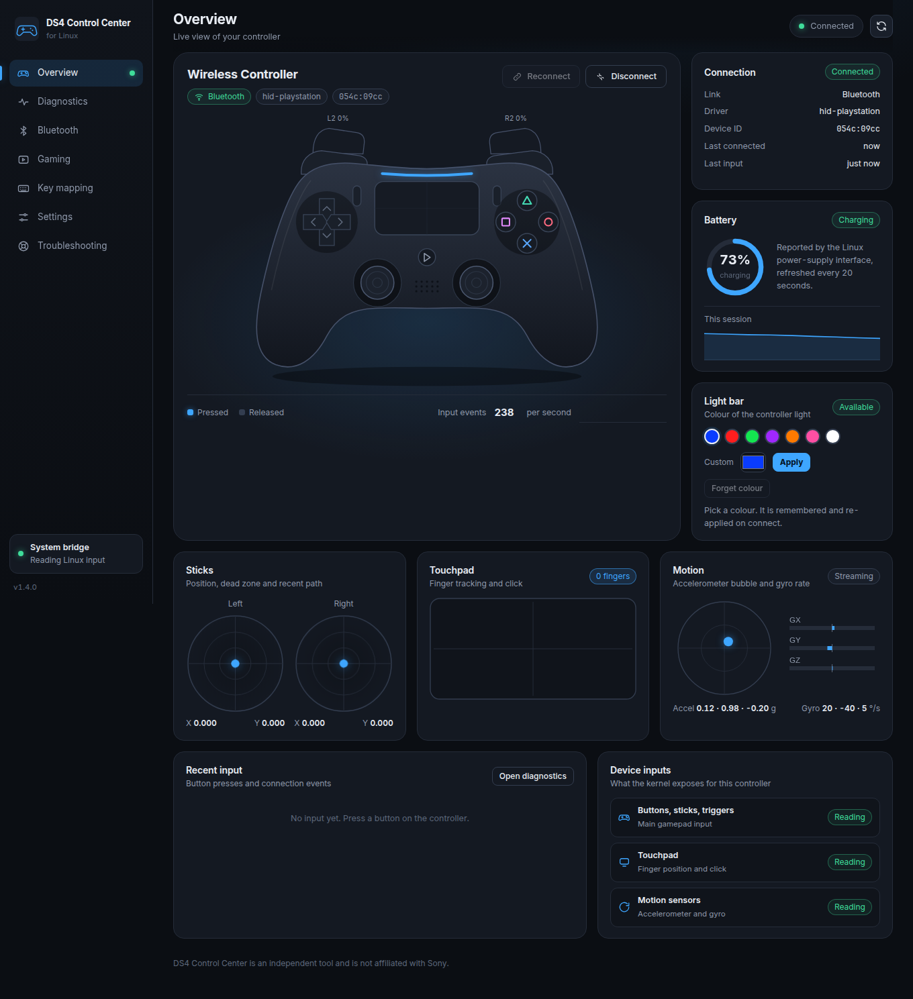
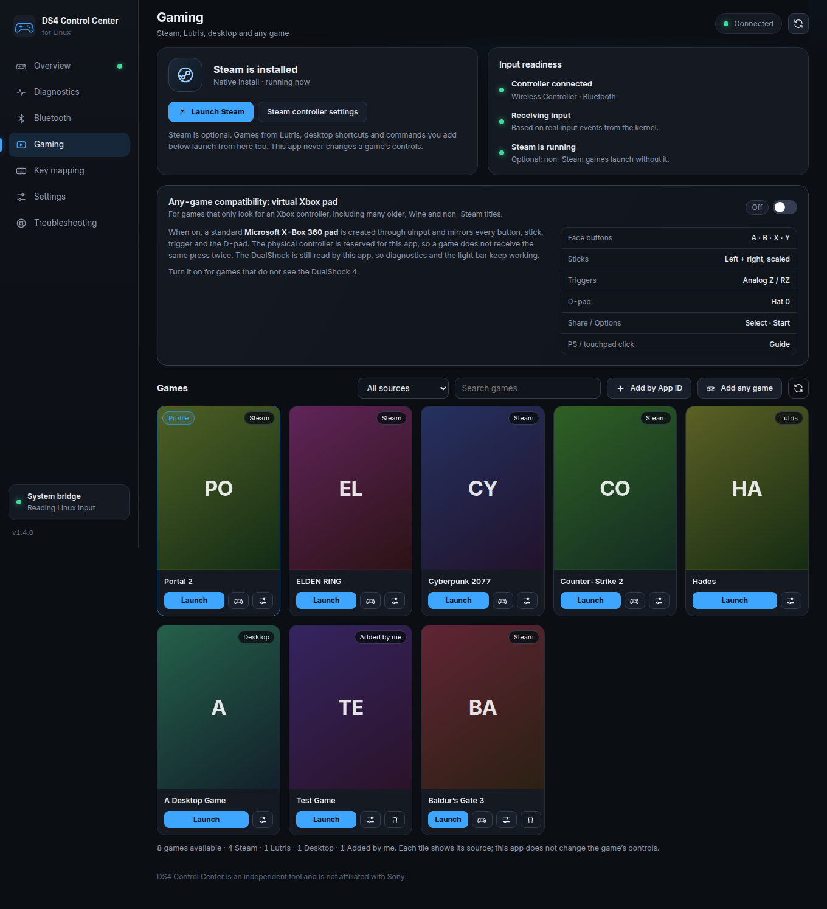
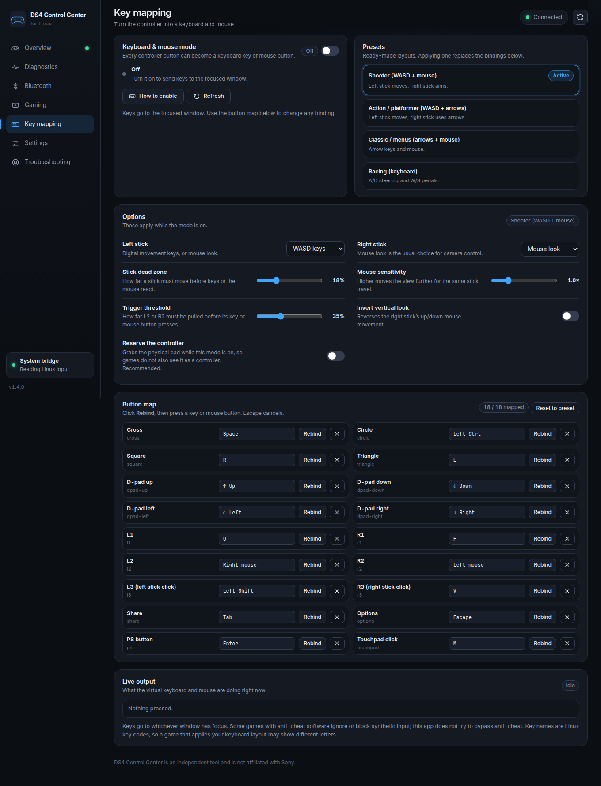
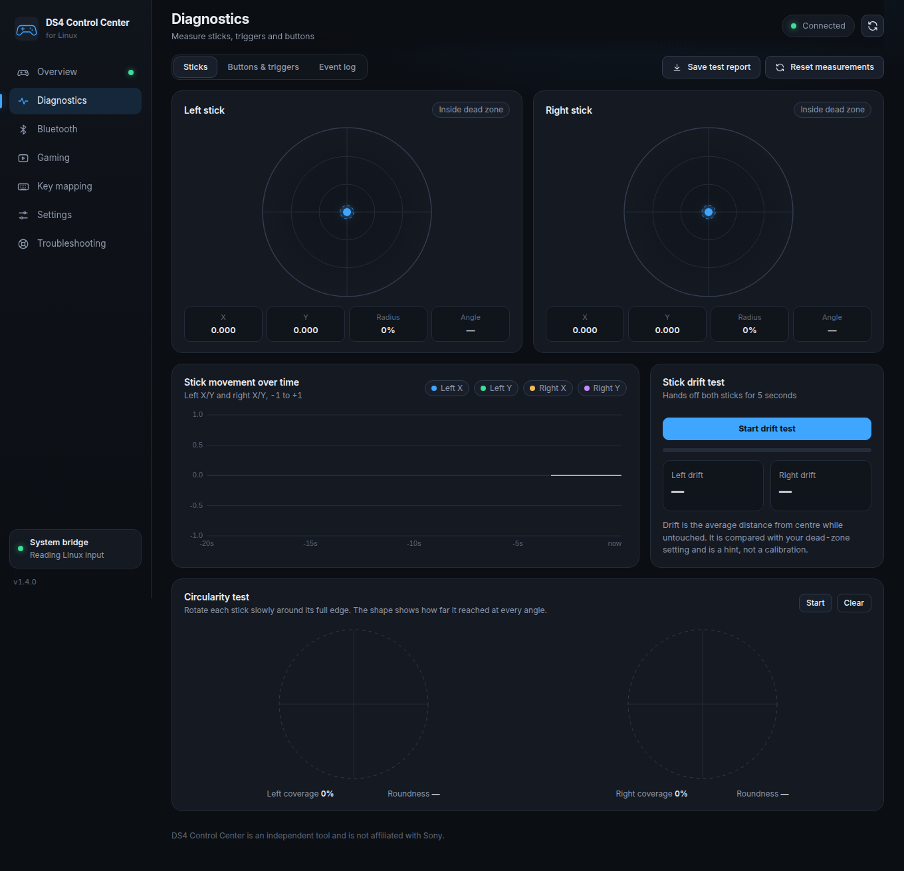

# Screenshot gallery

## v1.4.0

Captured from the actual frontend with `tests/ui_mock.js`. Connection status, input readings, battery values, game entries and permission states are simulated for documentation; these images do not demonstrate physical-controller or game compatibility tests.

### Overview

### Universal game library

### Keyboard and mouse mapping

### Diagnostics

## Earlier supplied captures

These images were already present in the working directory before release review. They retain their original contents and may display the earlier internal version number. Their capture conditions were not independently verified.

[Main view](main.png) · [Overview](overview.png) · [Diagnostics](diagnoses.png) · [Key mapping](keyboard-ds4.png) · [Settings](settings.png)
